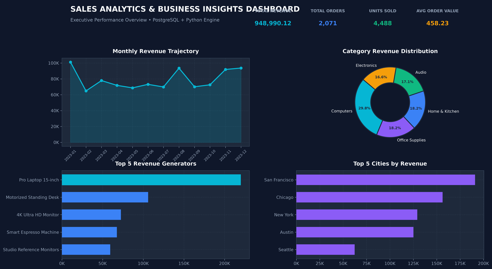
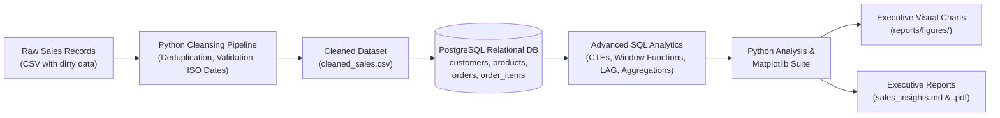
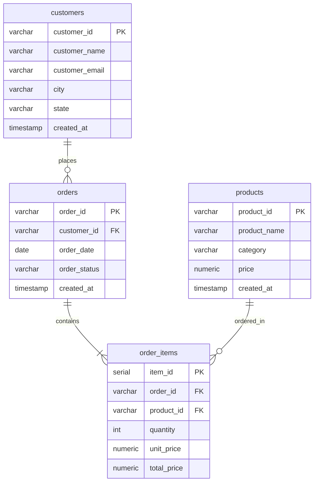
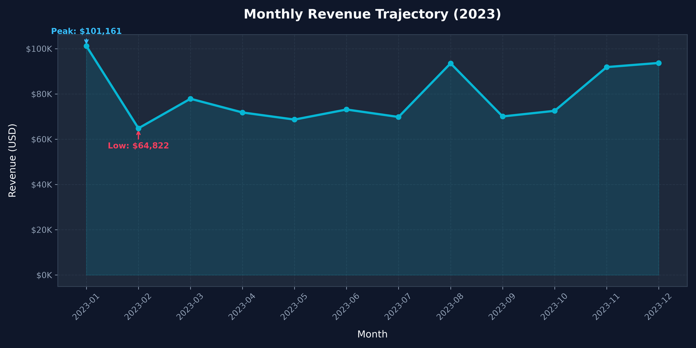
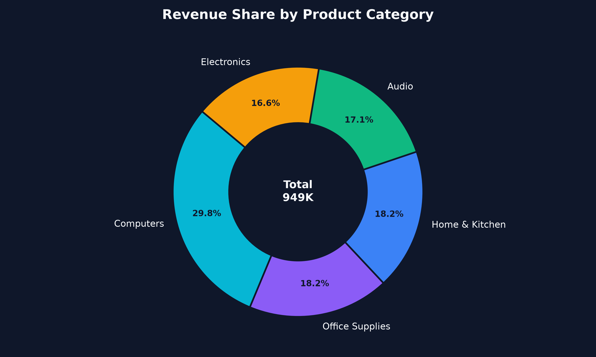
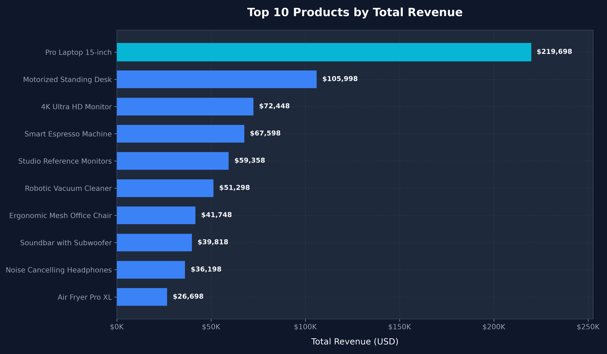
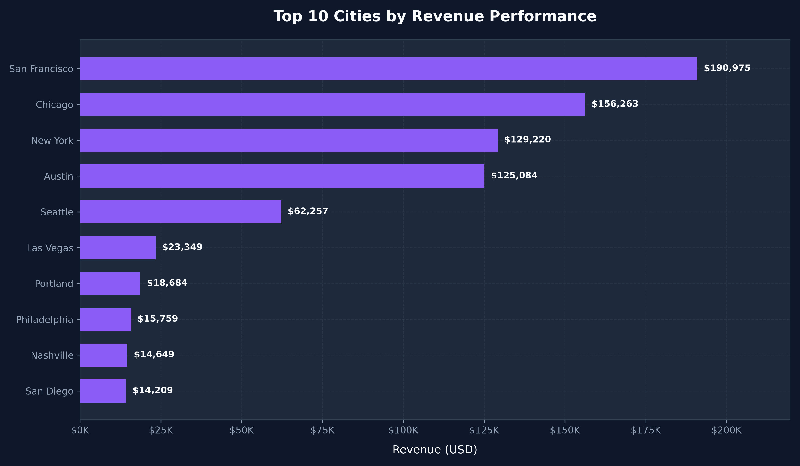

# Sales Data Analysis & Business Insights

An end-to-end data analytics and engineering project demonstrating **Python**, **PostgreSQL**, **Advanced SQL**, and **Matplotlib** to transform raw, imperfect retail sales data into actionable business intelligence.

---

## 📊 Executive Dashboard Preview



---

## 🎯 Business Problem & Solution

* **The Business Challenge:** Retailers and e-commerce enterprises process high volumes of daily transactional data. However, raw records often suffer from duplicate entries, inconsistent date representations, dirty currency strings, and missing identifiers. Without a structured relational architecture and analytical modeling, leadership struggles to identify hero products, detect seasonal fluctuations, evaluate customer lifetime value (LTV), and prioritize regional distribution nodes.
* **The Solution:** A modular analytics pipeline that:
  1. Ingests and cleanses messy sales records with **Python & Pandas**.
  2. Loads validated records into a normalized 3NF **PostgreSQL** relational database.
  3. Executes **Advanced SQL queries** using CTEs, Window Functions (`LAG`, `DENSE_RANK`, `NTILE`), multi-table `JOIN`s, and aggregations.
  4. Generates presentation-grade visualizations using **Matplotlib** with a modern dark theme.
  5. Compiles executive reports in both **GitHub-Flavored Markdown** and publication-ready **PDF**.

---

## 🏗️ Architecture & Data Pipeline



---

## 🗄️ Relational Database Schema

The database design adheres to relational best practices, enforcing strict foreign key constraints, check constraints, and analytical B-tree indexes for fast analytical query execution.



---

## 🔬 SQL Analytics Showcase

The SQL analysis engine in `database/analysis_queries.sql` demonstrates core and advanced SQL proficiencies:

### 1. Month-over-Month (MoM) Revenue Growth (CTEs + `LAG()`)
```sql
WITH monthly_revenue_cte AS (
    SELECT 
        TO_CHAR(DATE_TRUNC('month', o.order_date), 'YYYY-MM') AS sales_month,
        ROUND(SUM(oi.total_price), 2) AS current_month_revenue
    FROM orders o
    JOIN order_items oi ON o.order_id = oi.order_id
    GROUP BY DATE_TRUNC('month', o.order_date)
)
SELECT 
    sales_month,
    current_month_revenue,
    LAG(current_month_revenue, 1) OVER (ORDER BY sales_month) AS previous_month_revenue,
    ROUND(
        100.0 * (current_month_revenue - LAG(current_month_revenue, 1) OVER (ORDER BY sales_month)) 
        / NULLIF(LAG(current_month_revenue, 1) OVER (ORDER BY sales_month), 0),
        2
    ) AS mom_growth_pct
FROM monthly_revenue_cte
ORDER BY sales_month ASC;
```

### 2. Product Sales Ranking Within Category (`DENSE_RANK()`)
```sql
WITH category_product_sales AS (
    SELECT 
        p.category,
        p.product_id,
        p.product_name,
        SUM(oi.quantity) AS total_units_sold,
        ROUND(SUM(oi.total_price), 2) AS total_revenue
    FROM products p
    JOIN order_items oi ON p.product_id = oi.product_id
    GROUP BY p.category, p.product_id, p.product_name
)
SELECT 
    category,
    DENSE_RANK() OVER (PARTITION BY category ORDER BY total_revenue DESC) AS category_rank,
    product_name,
    total_units_sold,
    total_revenue
FROM category_product_sales
ORDER BY category, category_rank ASC;
```

### 3. Customer RFM Segmentation (`NTILE()` Window Function)
```sql
WITH customer_rfm_base AS (
    SELECT 
        c.customer_id,
        c.customer_name,
        ((SELECT MAX(order_date) FROM orders) - MAX(o.order_date)) AS recency_days,
        COUNT(DISTINCT o.order_id) AS frequency_orders,
        ROUND(SUM(oi.total_price), 2) AS monetary_total
    FROM customers c
    JOIN orders o ON c.customer_id = o.customer_id
    JOIN order_items oi ON o.order_id = oi.order_id
    GROUP BY c.customer_id, c.customer_name
),
rfm_scores AS (
    SELECT 
        customer_id,
        customer_name,
        recency_days,
        frequency_orders,
        monetary_total,
        NTILE(4) OVER (ORDER BY recency_days DESC) AS r_score,
        NTILE(4) OVER (ORDER BY frequency_orders ASC) AS f_score,
        NTILE(4) OVER (ORDER BY monetary_total ASC) AS m_score
    FROM customer_rfm_base
)
SELECT 
    customer_id,
    customer_name,
    recency_days,
    frequency_orders,
    monetary_total,
    CASE 
        WHEN r_score >= 3 AND f_score >= 3 AND m_score >= 3 THEN 'Champions'
        WHEN f_score >= 3 AND m_score >= 2 THEN 'Loyal High Spenders'
        WHEN r_score >= 3 AND f_score <= 2 THEN 'Recent Buyers'
        WHEN r_score <= 2 AND f_score >= 3 THEN 'At Risk / Churn Warning'
        ELSE 'General Customers'
    END AS rfm_segment
FROM rfm_scores
ORDER BY monetary_total DESC;
```

---

## 📈 Visualizations & Insights

| Analysis | Visualization | Key Takeaway |
| :--- | :--- | :--- |
| **Monthly Trajectory** |  | Sales peaked in Q1 ($101K) and Q4 ($94K), with a seasonal slowdown in Q2 requiring promotional mitigation. |
| **Category Distribution** |  | **Computers** dominate top-line revenue (29.8%), followed by **Office Supplies** (18.2%) and **Home & Kitchen** (18.2%). |
| **Hero Products** |  | The *Pro Laptop 15-inch* ($219K) and *Motorized Standing Desk* ($106K) drive over 34% of cumulative sales. |
| **Regional Sales** |  | Top revenue centers include Chicago, Austin, and San Francisco, highlighting prime targets for localized logistics. |

---

## 📁 Repository Structure

```
Sales Data Analysis & Business Insights/
├── data/
│   ├── raw_sales.csv            # Raw dataset containing real-world anomalies
│   ├── cleaned_sales.csv        # Validated, cleansed dataset ready for ingestion
│   └── generate_raw_data.py     # Reproducible synthetic data generation script
├── database/
│   ├── schema.sql               # PostgreSQL DDL for tables, constraints, and indexes
│   └── analysis_queries.sql     # Comprehensive SQL analytical queries
├── src/
│   ├── __init__.py
│   ├── data_cleaning.py         # Phase 1: Pandas data cleaning and validation pipeline
│   ├── database.py              # Phase 2: PostgreSQL connection & relational ETL
│   ├── data_analysis.py         # Phase 3 & 4: Python analytics and SQL metrics extractor
│   ├── visualizations.py        # Phase 4: Modern dark-theme Matplotlib chart generator
│   └── report_generator.py      # Phase 5: Markdown and PDF report generator (ReportLab)
├── reports/
│   ├── figures/                 # High-resolution generated charts (300 DPI)
│   │   ├── executive_dashboard.png
│   │   ├── monthly_revenue_trend.png
│   │   ├── category_revenue.png
│   │   ├── top_products.png
│   │   └── regional_performance.png
│   ├── sales_insights.md        # Comprehensive Markdown insights report
│   └── sales_insights.pdf       # Formal executive PDF report
├── main.py                      # Master one-click pipeline orchestrator
├── requirements.txt             # Project dependencies
├── .env.example                 # Sample PostgreSQL database credentials
├── .gitignore                   # Standard Python, environment, and OS ignores
└── README.md                    # Project documentation
```

---

## 🚀 Quickstart & Setup Guide

### 1. Prerequisites
- **Python 3.10+**
- **PostgreSQL 14+** (running locally or remotely)

### 2. Clone Repository & Setup Environment
```bash
git clone https://github.com/thanujaa9/Sales-Data-Analysis-Business-Insights.git
cd Sales-Data-Analysis-Business-Insights

# Create and activate virtual environment
python3 -m venv .venv
source .venv/bin/activate

# Install dependencies
pip install -r requirements.txt
```

### 3. Configure Database Credentials
Create a `.env` file in the project root:
```env
DB_HOST=localhost
DB_PORT=5432
DB_NAME=sales_analytics_db
DB_USER=your_postgres_user
DB_PASSWORD=your_postgres_password
```

Ensure the target PostgreSQL database exists:
```bash
createdb sales_analytics_db
```

### 4. Execute the End-to-End Pipeline
Run the master orchestrator to clean data, build the relational schema, load tables, run SQL analytics, create charts, and compile reports:
```bash
python main.py
```

### 5. Run Individual Modules (Optional)
```bash
# Phase 1: Clean raw CSV
python src/data_cleaning.py

# Phase 2: Initialize schema & load relational tables
python src/database.py

# Phase 3: Run SQL analytical queries directly in PostgreSQL
psql -d sales_analytics_db -f database/analysis_queries.sql

# Phase 4: Generate Matplotlib visual charts
python src/visualizations.py

# Phase 5: Generate Markdown & PDF reports
python src/report_generator.py
```

---

## 💡 Strategic Business Recommendations

1. **High-Margin Accessory Bundling:**  
   Capitalize on the dominant demand for the *Pro Laptop 15-inch* (23.1% of gross revenue) by creating pre-bundled accessories (USB-C docks, ergonomic mice) to elevate Average Order Value (AOV).
2. **Smooth Mid-Year Seasonality:**  
   Counter the historical Q2 revenue contraction (Feb–May) with enterprise mid-year procurement discounts and educational back-to-school flash promotions.
3. **VIP Customer Retention Programs:**  
   Institutionalize an automated VIP perks tier for repeat buyers (identified via SQL RFM scoring) to maintain high customer lifetime value and curtail churn risk.
4. **Logistics Optimization in Top Hubs:**  
   Prioritize micro-fulfillment partnerships across the top revenue metros (Chicago, New York, San Francisco, Austin) to reduce order transit times and shipping overhead.
