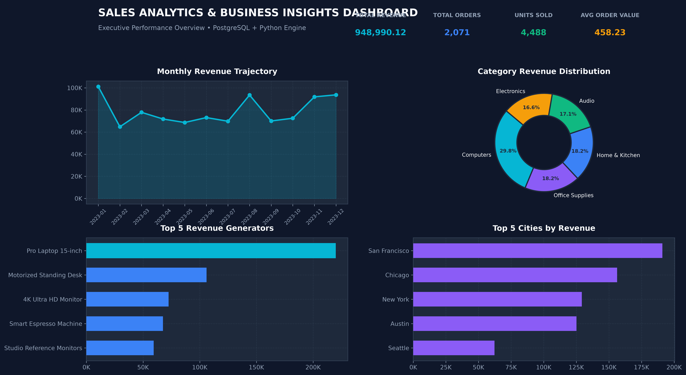
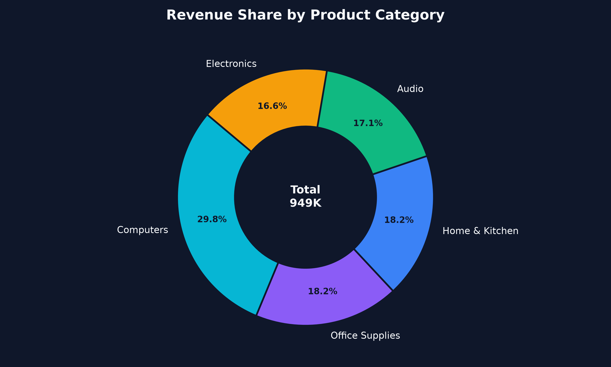
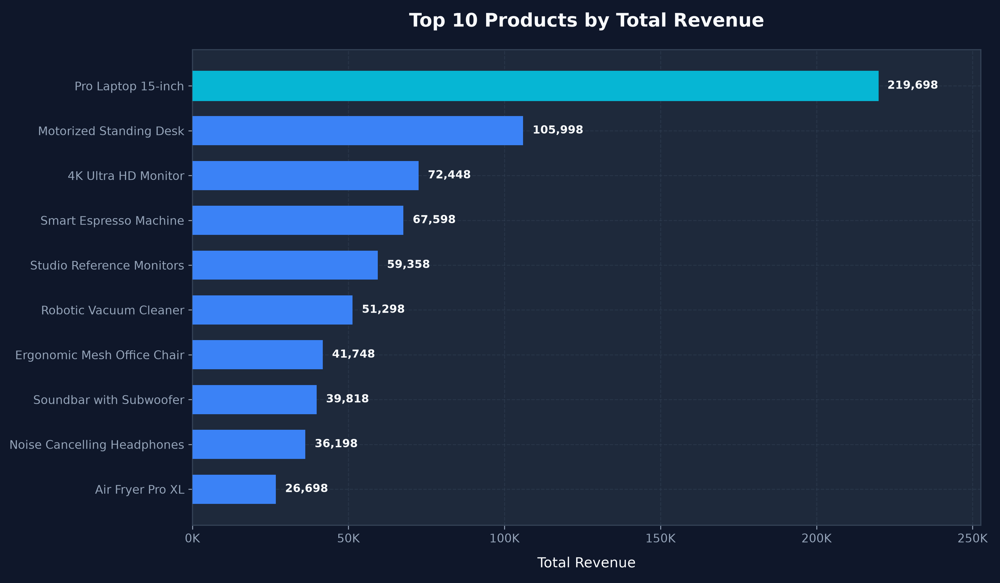
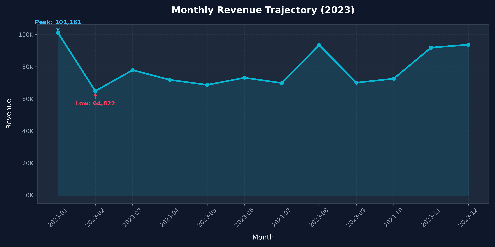
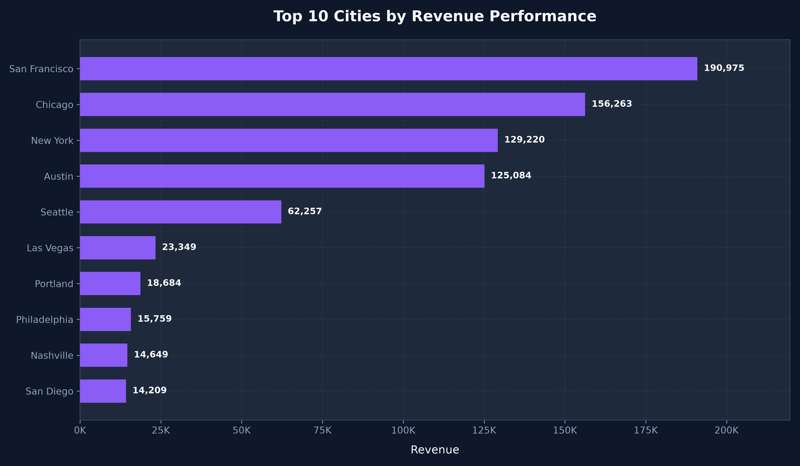

# Executive Sales Data Analysis & Business Insights Report

**Project Scope:** End-to-End Retail Sales Performance Analytics  
**Architecture:** Python + Pandas Data Pipeline • PostgreSQL Relational Database • Advanced SQL Analytics • Matplotlib Visualization  
**Reporting Period:** Full Year 2023  

---

## 1. Executive Summary & Core KPIs

During the analyzed operating period, the business achieved consistent transaction flow across diverse product categories and major metropolitan markets.

| Metric | Value | Business Significance |
| :--- | :--- | :--- |
| **Total Revenue** | **948,990.12** | Cumulative gross sales across all completed orders |
| **Total Completed Orders** | **2,071** | Total processed commercial orders |
| **Unique Customers** | **80** | Distinct purchasing customer base |
| **Total Units Sold** | **4,488** | Aggregate inventory units moved |
| **Average Order Value (AOV)** | **458.23** | Average spend per customer basket |
| **Top Category Contribution** | **Computers (29.83%)** | Primary revenue driver across product portfolio |
| **Hero Product** | **Pro Laptop 15-inch** | Highest grossing SKU generating 219,698.31 |

---

## 2. Executive Analytics Dashboard

---

## 3. Product Category Revenue Breakdown

The catalog is divided into 5 core merchandise segments. **Computers** generated the highest overall revenue share, followed by **Office Supplies** and **Home & Kitchen**.

| Product Category | Orders Count | Units Sold | Total Revenue | Revenue Share (%) |
| :--- | :---: | :---: | :---: | :---: |
| **Computers** | 379 | 819 | 283,111.81 | 29.83% |
| **Office Supplies** | 446 | 960 | 173,130.40 | 18.24% |
| **Home & Kitchen** | 379 | 823 | 173,016.77 | 18.23% |
| **Audio** | 442 | 951 | 162,580.49 | 17.13% |
| **Electronics** | 425 | 935 | 157,150.65 | 16.56% |

---

## 4. Top 10 Best-Selling Products Ranking

High-ticket electronics and premium computing equipment disproportionately anchor top-line performance, demonstrating strong purchasing power in prosumer segments.

| Rank | Product ID | Product Name | Category | Units Sold | Total Revenue |
| :---: | :--- | :--- | :--- | :---: | :---: |
| 1 | `PROD-006` | Pro Laptop 15-inch | Computers | 169 | 219,698.31 |
| 2 | `PROD-012` | Motorized Standing Desk | Office Supplies | 212 | 105,997.88 |
| 3 | `PROD-001` | 4K Ultra HD Monitor | Electronics | 207 | 72,447.93 |
| 4 | `PROD-016` | Smart Espresso Machine | Home & Kitchen | 169 | 67,598.31 |
| 5 | `PROD-021` | Studio Reference Monitors | Audio | 212 | 59,357.88 |
| 6 | `PROD-020` | Robotic Vacuum Cleaner | Home & Kitchen | 171 | 51,298.29 |
| 7 | `PROD-011` | Ergonomic Mesh Office Chair | Office Supplies | 167 | 41,748.33 |
| 8 | `PROD-025` | Soundbar with Subwoofer | Audio | 181 | 39,818.19 |
| 9 | `PROD-002` | Noise Cancelling Headphones | Electronics | 181 | 36,198.19 |
| 10 | `PROD-017` | Air Fryer Pro XL | Home & Kitchen | 178 | 26,698.22 |

---

## 5. Monthly Revenue Trajectory & Growth Patterns

| Month | Total Orders | Units Sold | Monthly Revenue | MoM Growth (%) |
| :---: | :---: | :---: | :---: | :---: |
| **2023-01** | 171 | 353 | 101,161.47 | Baseline (N/A) |
| **2023-02** | 160 | 347 | 64,821.53 | -35.92% |
| **2023-03** | 172 | 375 | 77,876.25 | +20.14% |
| **2023-04** | 174 | 380 | 71,816.20 | -7.78% |
| **2023-05** | 163 | 346 | 68,676.54 | -4.37% |
| **2023-06** | 163 | 380 | 73,121.20 | +6.47% |
| **2023-07** | 173 | 357 | 69,826.43 | -4.51% |
| **2023-08** | 198 | 435 | 93,525.65 | +33.94% |
| **2023-09** | 163 | 338 | 70,056.62 | -25.09% |
| **2023-10** | 162 | 352 | 72,541.48 | +3.55% |
| **2023-11** | 175 | 405 | 91,870.95 | +26.65% |
| **2023-12** | 197 | 420 | 93,695.80 | +1.99% |

---

## 6. Top 10 High-Value Customers

| Customer ID | Name | City | State | Total Orders | Total Units | Lifetime Spend | AOV |
| :--- | :--- | :--- | :---: | :---: | :---: | :---: | :---: |
| `CUST-1058` | Customer 28 | Chicago | NY | 34 | 73 | 27,984.27 | 823.07 |
| `CUST-1070` | Customer 40 | Austin | CA | 28 | 61 | 26,144.39 | 933.73 |
| `CUST-1023` | Elizabeth King | Las Vegas | NV | 25 | 59 | 23,349.41 | 933.98 |
| `CUST-1054` | Customer 24 | New York | TX | 18 | 48 | 22,904.52 | 1,272.47 |
| `CUST-1013` | Evelyn Thomas | Portland | OR | 26 | 71 | 18,684.29 | 718.63 |
| `CUST-1041` | Customer 11 | Chicago | WA | 32 | 78 | 17,144.22 | 535.76 |
| `CUST-1052` | Customer 22 | San Francisco | NY | 28 | 78 | 17,044.22 | 608.72 |
| `CUST-1042` | Customer 12 | Austin | IL | 36 | 79 | 16,559.21 | 459.98 |
| `CUST-1078` | Customer 48 | Austin | TX | 29 | 68 | 16,459.32 | 567.56 |
| `CUST-1034` | Customer 4 | New York | WA | 26 | 53 | 16,224.47 | 624.02 |

---

## 7. Regional Market Performance (Top 10 Cities)

| City | Orders Count | Customers Count | Units Sold | Total Revenue | Avg Order Value |
| :--- | :---: | :---: | :---: | :---: | :---: |
| **San Francisco** | 430 | 17 | 976 | 190,975.24 | 444.13 |
| **Chicago** | 334 | 12 | 741 | 156,262.59 | 467.85 |
| **New York** | 276 | 11 | 550 | 129,219.50 | 468.19 |
| **Austin** | 255 | 10 | 578 | 125,084.22 | 490.53 |
| **Seattle** | 132 | 5 | 328 | 62,256.72 | 471.64 |
| **Las Vegas** | 25 | 1 | 59 | 23,349.41 | 933.98 |
| **Portland** | 26 | 1 | 71 | 18,684.29 | 718.63 |
| **Philadelphia** | 25 | 1 | 55 | 15,759.45 | 630.38 |
| **Nashville** | 31 | 1 | 63 | 14,649.37 | 472.56 |
| **San Diego** | 28 | 1 | 57 | 14,209.43 | 507.48 |

---

## 8. Strategic Business Recommendations

Based on the empirical findings generated by the SQL analytics and data processing pipeline:

1. **Capitalize on Hero Computing Products:**
   - The *Pro Laptop 15-inch* accounts for over 23% of total revenue. Implement automated bundling (e.g. bundle with USB-C Hubs, Ergonomic Mice, and Laptop Sleeves) to boost basket size without discounting core hardware margins.

2. **Mitigate Mid-Year Seasonality Dip:**
   - Revenue reaches historical lows during Q2 (February - May). Deploy targeted mid-year corporate hardware refresh campaigns and spring promotional flash sales to smooth revenue volatility.

3. **High-Value Loyalty Retention (VIP Tier):**
   - The top 10 customers represent disproportionate lifetime spending. Establish an exclusive VIP rewards tier offering priority delivery, extended warranties, and dedicated support to safeguard high-LTV accounts.

4. **Geographic Expansion & Regional Inventory Hubs:**
   - Leading metropolitan hubs (Chicago, New York, San Francisco, Austin, Seattle) account for over 50% of orders. Establishing micro-fulfillment nodes or localized shipping partnerships in these regions will reduce shipping latency and last-mile logistics overhead.

5. **Cross-Selling Into Home & Office Categories:**
   - Ergonomic Office Chairs and Standing Desks boast high profit contributions. Trigger automated post-purchase email flows offering ergonomic furniture discounts to laptop and monitor purchasers.

---
*Report automatically compiled by Sales Analytics Pipeline Engine.*
